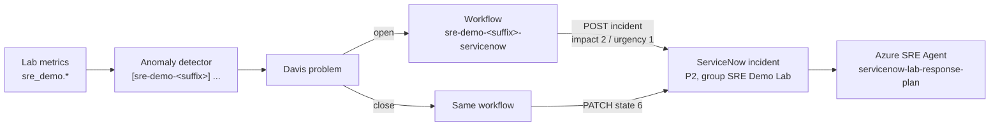

# Manual setup: Dynatrace and ServiceNow

`deploy.sh` builds everything in this guide automatically. Use this page when you want to
build the integration by hand: to understand it, to wire it into an existing Dynatrace or
ServiceNow environment, or because the automated step failed.

Every value below is taken from the Terraform that the deployment applies, so a manual build
behaves exactly like an automated one. If the two ever disagree, the Terraform is right:

| What | Source of truth |
|---|---|
| Thresholds, DQL, detector titles | [`infra/terraform/integration/dynatrace.tf`](../infra/terraform/integration/dynatrace.tf) (`metric_events`) |
| Anomaly detectors, credential, workflow | [`infra/terraform/integration/dynatrace-platform.tf`](../infra/terraform/integration/dynatrace-platform.tf) |
| Workflow script | [`infra/terraform/integration/workflow/servicenow-incident.js`](../infra/terraform/integration/workflow/servicenow-incident.js) |
| Scenario 01 log ingest | [`infra/terraform/integration/dynatrace-logs.tf`](../infra/terraform/integration/dynatrace-logs.tf) |
| ServiceNow group, user, role | [`infra/terraform/integration/servicenow.tf`](../infra/terraform/integration/servicenow.tf) |
| SRE Agent wiring | [`scripts/configure-sre-agent-integrations.sh`](../scripts/configure-sre-agent-integrations.sh) |

> The UI paths below reflect the Dynatrace and ServiceNow releases current when this was
> written. Menu names move between releases; the object types and field values do not.

## Contents

- [The contract](#the-contract)
- [0. Start from a lab without the integration](#0-start-from-a-lab-without-the-integration)
- [1. ServiceNow: group, integration user, role](#1-servicenow-group-integration-user-role)
- [2. Dynatrace: anomaly detectors](#2-dynatrace-anomaly-detectors)
- [3. Dynatrace: let workflows reach ServiceNow](#3-dynatrace-let-workflows-reach-servicenow)
- [4. Dynatrace: credential](#4-dynatrace-credential)
- [5. Dynatrace: workflow](#5-dynatrace-workflow)
- [6. Dynatrace: scenario 01 log ingest (optional)](#6-dynatrace-scenario-01-log-ingest-optional)
- [7. Azure SRE Agent: connector, incident platform, response plan](#7-azure-sre-agent-connector-incident-platform-response-plan)
- [8. Test it](#8-test-it)
- [Classic Dynatrace environments](#classic-dynatrace-environments)

---

## The contract

Everything else depends on these rules:



| Rule | Value | Why it matters |
|---|---|---|
| Title prefix | `[sre-demo-<suffix>]` on every detector | The workflow trigger matches on it, so several labs can share one Dynatrace environment |
| Assignment group | `SRE Demo Lab` | The agent indexes only this group |
| Priority | impact `2` + urgency `1` = **priority 2 – High** | The response plan accepts priority 1–2 only |
| Correlation | `correlation_id = dynatrace-<problem display id>` | Prevents duplicate incidents; lets the workflow resolve the right one; used by `reset-lab.sh` |
| Close behaviour | problem closes → incident state `6` (Resolved), close code `Resolved by caller` | Skipped if the incident is already Resolved, Closed or Canceled |

`<suffix>` is your lab suffix (for example `2082a5`). It appears in resource names such as
`rg-sre-demo-<suffix>`.

---

## 0. Start from a lab without the integration

The detectors read custom metrics (`sre_demo.*`) that the lab's apps send to Dynatrace using
tokens that the deployment creates, and OneAgent must be on the VMs and AKS. Let the deployment
do that part and skip only the routing:

```bash
./scripts/deploy.sh --skip-servicenow ...   # Dynatrace data + detectors, no ServiceNow routing
```

With `--skip-servicenow` the [anomaly detectors](#2-dynatrace-anomaly-detectors) and the
[log ingest](#6-dynatrace-scenario-01-log-ingest-optional) are already created, so you can go
straight from step 1 to step 3. Build them by hand only if you are wiring a different
environment.

Before you continue, check that the metrics are arriving. In a **Notebook**, run:

```text
timeseries value = max(sre_demo.disk_percent_used), filter: lab.suffix == "<suffix>"
```

You should see a line. No data means the routing has nothing to fire on; fix that first
([DYNATRACE-SETUP.md → Troubleshooting](DYNATRACE-SETUP.md#troubleshooting)).

---

## 1. ServiceNow: group, integration user, role

Sign in as an admin. The admin account is used only for this step; Dynatrace and the agent
use the integration user.

### 1.1 Assignment group

**All → User Administration → Groups → New**

| Field | Value |
|---|---|
| Name | `SRE Demo Lab` |
| Description | `Incidents raised by Dynatrace for the Azure SRE Agent demo lab (<suffix>). The SRE Agent is scoped to this group.` |
| Active | ✔ |

### 1.2 Integration user

**All → User Administration → Users → New**

| Field | Value |
|---|---|
| User ID | `sre_demo_integration` |
| First name / Last name | `SRE Demo` / `Integration` |
| Password | A strong password (the deployment generates 24 characters with upper, lower, digits and `!#%*-_=+`). Keep it; you need it in steps 4 and 7. |
| Password needs reset | ✘ |
| Web service access only | ✔ (the account can call the APIs but cannot sign in to the UI) |
| Active | ✔ |

Save, then on the same user record:

- **Roles** tab → **Edit** → add `itil`. That is enough to create, read and update incidents.
- **Groups** tab → **Edit** → add `SRE Demo Lab`.

### 1.3 Check it

From any machine, with the password you set:

```bash
curl -s -u 'sre_demo_integration:<password>' \
  -H 'Accept: application/json' \
  'https://<instance>.service-now.com/api/now/table/incident?sysparm_limit=1&sysparm_fields=number'
```

HTTP 200 with a `result` array means the account works. A 401 usually means the password was
typed differently, or **Password needs reset** is still ticked.

---

## 2. Dynatrace: anomaly detectors

Skip this if you deployed with `--skip-servicenow` (they already exist).

Open the **Anomaly Detection** app → **Custom alerts** → **New**. Create one alert for each
row in the table below. Settings shared by all eight:

| Setting | Value |
|---|---|
| Analyzer | **Static threshold** |
| Alert on missing data | Off |
| Sliding window | `3` samples |
| Violating samples | `2` |
| Dealerting samples | `3` |
| Event property `event.name` | `[sre-demo-<suffix>] <title>` (the title from the table) |
| Event property `event.type` | `RESOURCE_CONTENTION_EVENT` or `ERROR_EVENT` (table) |
| Event property `event.description` | the description from `dynatrace.tf`, followed by ` Lab: <suffix>.` |
| Event property `sre.demo.scenario` | the scenario key (table) |
| Event property `sre.demo.lab` | `<suffix>` |

The detector **title** and **`event.name`** must both start with `[sre-demo-<suffix>]`; the
workflow in step 5 does not fire for anything else.

In the DQL below, `LAB` stands for `filter: lab.suffix == "<suffix>"`, and `AKS` stands for:

```text
by: {dt.entity.host}, filter: in(dt.entity.host, classicEntitySelector("type(HOST),fromRelationships.isInstanceOf(type(HOST_GROUP),entityName.equals(\"sre-demo-aks-<suffix>\"))"))
```

| Scenario key | Title (after the prefix) | DQL | Condition | Threshold | `event.type` |
|---|---|---|---|---|---|
| `01-disk-capacity` | `01 App VM demo disk capacity` | `timeseries value = max(sre_demo.disk_percent_used), LAB` | Above | `85` | `RESOURCE_CONTENTION_EVENT` |
| `02-aks-node-cpu` | `02 AKS node CPU pressure` | `timeseries value = max(dt.host.cpu.usage), AKS` | Above | `80` | `RESOURCE_CONTENTION_EVENT` |
| `02-aks-node-memory` | `02 AKS node memory pressure` | `timeseries value = max(dt.host.memory.usage), AKS` | Above | `80` | `RESOURCE_CONTENTION_EVENT` |
| `02-aks-pending-pods` | `02 AKS pods cannot be scheduled` | `timeseries value = max(sre_demo.aks_pending_pods), LAB` | Above | `0.5` | `RESOURCE_CONTENTION_EVENT` |
| `03-http-failure-rate` | `03 Magic 8 Ball HTTP failure rate` | `timeseries value = avg(sre_demo.magic8ball_request_failed), LAB` | Above | `0.2` | `ERROR_EVENT` |
| `04-postgres-connections` | `04 PostgreSQL connection utilisation` | `timeseries value = max(sre_demo.postgres_connection_percent), LAB` | Above | `80` | `RESOURCE_CONTENTION_EVENT` |
| `05-postgres-connectivity` | `05 PostgreSQL dependency failures` | `timeseries value = min(sre_demo.postgres_connectivity), LAB` | Below | `1` | `ERROR_EVENT` |
| `06-tls-certificate` | `06 Magic 8 Ball TLS validation failing` | `timeseries value = min(sre_demo.magic8ball_tls_valid), LAB` | Below | `1` | `ERROR_EVENT` |

For the two `AKS` detectors, also add the event property `dt.source_entity` =
`{dims:dt.entity.host}`, so the problem is attached to the affected node.

Thresholds are the Terraform defaults (`disk_threshold_percent`, `node_pressure_threshold_percent`,
`failure_rate_threshold_percent` ÷ 100, `connection_threshold_percent`). The scenarios are
calibrated to them; if you change one, change the matching variable too.

---

## 3. Dynatrace: let workflows reach ServiceNow

Workflow JavaScript can only call hosts on the environment's outbound allowlist.

**Settings → General → External requests**: if the list is enforced, add
`<instance>.service-now.com`. If outbound connections are not restricted, there is nothing to do.

Also give the one-time consent that lets workflows run as you. This can only be done by hand,
even in an automated deployment:
[DYNATRACE-SETUP.md → Allow workflows to run as you](DYNATRACE-SETUP.md#latest-dynatrace-allow-workflows-to-run-as-you-one-time).

---

## 4. Dynatrace: credential

The workflow reads the ServiceNow password from the credential vault at run time, so it never
appears in the workflow definition.

**Settings → Credential vault → Add new credential**

| Field | Value |
|---|---|
| Name | `sre-demo-<suffix>-servicenow` |
| Type | User and password |
| Username / Password | `sre_demo_integration` / the password from step 1.2 |
| Scope | **App Engine** |
| Owner access only | ✔ |
| Allow contextless requests | ✔ (**required**) |

**Allow contextless requests** matters. A run started by a problem has no user context, and
without this the workflow fails with HTTP 403 *"cannot be accessed by the current user or
entity"*. Manual test runs do have a user context, so they succeed either way and hide the
problem.

Copy the credential's ID (`CREDENTIALS_VAULT-…`); step 5 needs it.

---

## 5. Dynatrace: workflow

Open the **Workflows** app → **New workflow**, named `sre-demo-<suffix>-servicenow`.

### 5.1 Trigger

Choose **Davis problem trigger**:

| Setting | Value |
|---|---|
| Fire on | Problem **open and close** (not open only; the close event resolves the incident) |
| Categories | Availability, Error, Slowdown, Resource, Custom, Monitoring unavailable (all except Info) |
| Custom filter | `matchesValue(event.name, "[sre-demo-<suffix>]*")` |

### 5.2 Task

Add a **Run JavaScript** task named `create_incident`. Paste the contents of
[`workflow/servicenow-incident.js`](../infra/terraform/integration/workflow/servicenow-incident.js),
then replace the `__CONFIG__` placeholder with your values:

```js
const CONFIG = {
  "titlePrefix": "[sre-demo-<suffix>]",
  "credentialId": "CREDENTIALS_VAULT-<id from step 4>",
  "instanceUrl": "https://<instance>.service-now.com",
  "appsUrl": "https://<env-id>.apps.dynatrace.com",
  "assignmentGroup": "SRE Demo Lab",
  "workflowName": "sre-demo-<suffix>-servicenow"
};
```

When a problem **opens**, the script:

1. reads the credential;
2. looks for an incident with `correlation_id = dynatrace-<display id>`, so retries never
   create a duplicate;
3. if none exists, sends `POST /api/now/table/incident?sysparm_input_display_value=true` with
   this body (the query parameter lets the group be given by name):

   ```json
   {
     "short_description": "<problem name>",
     "description": "Dynatrace problem <id> (<status>, category <category>)\nImpacted: <entities>\nProblem: <problem URL>",
     "assignment_group": "SRE Demo Lab",
     "correlation_id": "dynatrace-<display id>",
     "correlation_display": "Dynatrace",
     "category": "software",
     "impact": "2",
     "urgency": "1",
     "work_notes": "Raised automatically by the Dynatrace workflow sre-demo-<suffix>-servicenow."
   }
   ```

When a problem **closes**, it finds the same incident and, unless the incident is already
Resolved, Closed or Canceled (state ≥ 6), sends a `PATCH` with `state: 6`,
`close_code: Resolved by caller` and close notes naming the problem.

**Save** and **Deploy** the workflow.

---

## 6. Dynatrace: scenario 01 log ingest (optional)

OneAgent discovers system logs by itself, but not the scenario 01 log files. Without this the
agent can still diagnose scenario 01 from metrics; it just has no log lines to quote.
Skip this if you deployed with `--skip-servicenow`.

**Settings → Log Monitoring → Custom log sources → Add**

| Field | Value |
|---|---|
| Name | `[sre-demo-<suffix>] scenario 01 application logs` |
| Type | Log path pattern |
| Path | `/var/sre-demo/logs/sre-demo-scenario-01-1*.log` |
| Enrichment | attribute `lab.suffix` = `<suffix>` |

The `-1*` in the path is deliberate. It matches the timestamped log files but not the large
`sre-demo-scenario-01-archive-*.log` files that fill the disk.

A run writes about 2 GB, so keep only the root-cause lines. In
**Settings → Log Monitoring → Log ingest rules**, add two rules and **move both to the top of
the list** (rules are first-match-wins, and a built-in rule near the top would otherwise
store everything):

| Order | Name | Matchers | Action |
|---|---|---|---|
| 1 | `[sre-demo-<suffix>] keep scenario 01 retry-storm errors` | `log.source` matches the path above **and** `log.content` matches `*retry_storm=true*` | Include in storage |
| 2 | `[sre-demo-<suffix>] drop other scenario 01 log lines` | `log.source` matches the path above | Exclude from storage |

---

## 7. Azure SRE Agent: connector, incident platform, response plan

The agent side is already written up for the portal:

| Piece | Where |
|---|---|
| Dynatrace MCP connector, and **Edit → MCP Tools → Select all** | [AZURE-SRE-AGENT-SETUP.md §9](AZURE-SRE-AGENT-SETUP.md#9-connect-dynatrace-and-servicenow) |
| ServiceNow incident platform (Basic auth as `sre_demo_integration`, group `SRE Demo Lab`), response plan for priority 1–2 | [SERVICENOW-SETUP.md §3](SERVICENOW-SETUP.md#3-connect-azure-sre-agent-automated) (see the portal fallback paragraph) |
| Platform token scopes for the connector | [DYNATRACE-SETUP.md §3](DYNATRACE-SETUP.md#3-platform-token--dt_platform_token-dt0s16) |
| Let the agent act without asking (Autonomous mode, access level High) | [AZURE-SRE-AGENT-SETUP.md → Autonomous end-to-end test](AZURE-SRE-AGENT-SETUP.md#autonomous-end-to-end-test-scenario-05) |

Only one incident platform can be active on an agent. Connecting ServiceNow replaces Azure
Monitor as its incident source.

---

## 8. Test it

1. **Workflow alone.** Start a run with a fake problem as its event. The deployment's smoke
   test does the same thing (`dt_workflow_smoke_test` in `scripts/lib-integrations.sh`). Use the
   platform token and the workflow ID from the Workflows app:

   ```bash
   curl -s -X POST "https://<env-id>.apps.dynatrace.com/platform/automation/v1/workflows/<workflow-id>/run" \
     -H "Authorization: Bearer $DT_PLATFORM_TOKEN" -H 'Content-Type: application/json' \
     -d '{"params":{"event":{"event.name":"[sre-demo-<suffix>] manual test","event.id":"manual-test-1","display_id":"P-MANUAL-1","event.status":"ACTIVE"}}}'
   ```

   In the Workflows app, the `create_incident` task should return `created: true` and an
   incident number. Run it again and it should return `created: false` with the same number.
   Resolve that incident afterwards; replay the request with `"event.status":"CLOSED"` to
   test the resolve path.

2. **Whole loop.** Inject scenario 05 from the controller. Within about 3–5 minutes you should
   see a Dynatrace problem, then a P2 incident in `SRE Demo Lab`, and within about a minute the
   agent picks it up. After you reset the scenario, the problem closes and the incident is
   resolved. The screenshots in the
   [README](../README.md#what-the-end-to-end-flow-looks-like) show what each stage looks like.

3. **Automated check.** `./scripts/validate.sh` still checks the detectors (by title prefix)
   and the agent's Dynatrace connector. Its ServiceNow login and workflow checks run only when the
   deployment itself configured ServiceNow, so after a `--skip-servicenow` deploy they are
   skipped; use the `curl` checks in steps 1.3 and 8.1 instead.

| Symptom | Likely cause |
|---|---|
| Problem opens, workflow never runs | Detector title doesn't start with the exact prefix, or the workflow isn't deployed |
| Workflow fails with 403 on the credential | **Allow contextless requests** not ticked (step 4) |
| Workflow fails reaching ServiceNow | Host not on the outbound allowlist (step 3) |
| Incident created but the agent ignores it | Not priority 2 (check impact/urgency), not in `SRE Demo Lab`, or no response plan |
| Incident never resolves | Trigger fires on open only (step 5.1) |

---

## Classic Dynatrace environments

Classic environments (no Workflows app) use different objects for the same contract:

- **Metric events** instead of anomaly detectors: **Settings → Anomaly detection → Metric
  events**, one for each row of the table in step 2. Use the classic metric selector from
  `metric_events[*].selector` in `dynatrace.tf`, a static threshold, 3 samples, 2 violating,
  3 dealerting, and the same title.
- **Alerting profile** `sre-demo-<suffix>`: all severities, delay 0, with a custom event
  filter **title begins with** `[sre-demo-<suffix>]`.
- **Problem notification → Custom integration (webhook)** `sre-demo-<suffix>-servicenow`,
  using that profile:
  - URL `https://<instance>.service-now.com/api/now/table/incident?sysparm_input_display_value=true`
  - Headers `Content-Type: application/json`, `Accept: application/json`, and
    `Authorization: Basic <base64 of sre_demo_integration:password>`
  - Payload: `snow_incident_payload` in `dynatrace.tf`
  - **Notify closed problems** off: the classic webhook only creates incidents and can't
    resolve them. Resolve them by hand or with `reset-lab.sh`.
